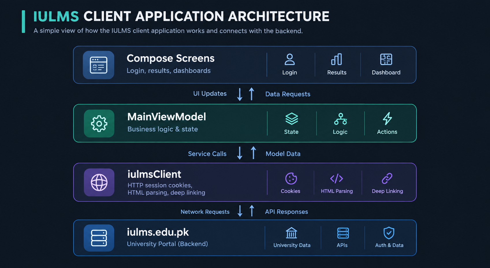

<p align="center">
  
</p>

<h1 align="center">MyIULMS</h1>

<p align="center">
  <strong>A modern, unofficial Android client for Iqra University IULMS.</strong>
</p>

<p align="center">
  
  
  
  <a href="https://github.com/Muhammmad-Ashhad-Ansari/MyIULMS/blob/main/LICENSE">
    
  </a>
</p>

<p align="center">
  Kotlin · Jetpack Compose · Material 3 · OkHttp · Jsoup
</p>

<p align="center">
  <a href="https://github.com/Muhammmad-Ashhad-Ansari/MyIULMS/releases/tag/v1.2.0"><strong>⬇ Download v1.2.0 APK</strong></a>
  ·
  <a href="https://github.com/Muhammmad-Ashhad-Ansari/MyIULMS/issues">Report an issue</a>
</p>

---

## MyIULMS: Your Academic Day, One Tap Away

Need to check your class, results, transcript, or fee vouchers? With the browser portal, that can mean going from login to the portal home, opening SIC, dismissing pop-ups, and then finding the page you need.

**MyIULMS brings the everyday academic essentials closer.** Open the app directly to your schedule, then move easily between attendance, results, transcript, and vouchers.

## Made for the things students check most

- **Know what’s happening in class:** See whether a class is live or coming up, its duration, and the time remaining.
- **Check attendance at a glance:** Open your attendance information without navigating through the wider portal.
- **Keep results and records handy:** View results and transcript details, and share result, transcript, or schedule as an image.
- **Track degree progress:** See completed credit hours and progress toward degree completion.
- **Stay ahead of vouchers:** Review voucher due or overdue status and the total outstanding amount.

**Less time finding the right page. More time getting on with your day.**

MyIULMS is a focused companion for common student tasks. The university portal remains the place for its broader services; the app makes frequently checked academic information easier to reach.

---

## Sign in knowing where your login goes

The most common reason students hesitate is the password field: *where does my IULMS password go?* The sign-in screen answers that on the screen itself, before you type anything.

- **Straight to the university.** Your registration number and password are sent over HTTPS directly to `iulms.edu.pk`, exactly as a browser would. MyIULMS has no server, no student database, no analytics and no tracking.
- **Said once, plainly.** A single chip, *Direct to iulms.edu.pk, no middle server*, sits above the form. Tap it for a four-step explanation of the sign-in flow and a link to the [interactive guide](https://muhammmad-ashhad-ansari.github.io/MyIULMS/).
- **Opt-in storage.** *Remember me* is off by default. Turned on, your login is kept encrypted on this phone only; turned off, it is not saved.
- **Honest branding.** The screen uses the MyIULMS icon, not the university's crest, and states that the app is unofficial and not affiliated with Iqra University.

The wording deliberately says the login *is* transmitted, to `iulms.edu.pk` and nowhere else, rather than "never leaves your phone". The full, source-checked account is in [Trust and privacy](#trust-and-privacy).

> The redesigned sign-in screen is on `main` and will ship in the next release; the v1.2.0 APK above still has the previous screen.

---

## Core modules

| Module | What you get |
|---|---|
| **Schedule** | Weekly classes and exams, weekday shortcut bar, class times with duration, room and faculty |
| **Attendance** | Course-wise present/absent totals, percentage, expandable session records |
| **Result** | Course marks, totals, grades, grade points, semester GPA, and academic insights |
| **Transcript** | CGPA, courses, credit hours, grades, GPA values, and degree progress |
| **Vouchers** | Fee amounts, due dates, due/overdue indicators, save or print as PDF |
| **Class reminders** | Optional notification before each class (5, 10 or 15 minutes, your choice) and at class start, built on the phone from the cached schedule |
| **Home-screen widget** | Your next class at a glance, from the encrypted offline schedule (Remember me on) |

Across every module: **sign in with session recovery**, **password-manager support**, **shareable images**, and **light/dark themes** with a saved preference.

---

## Design system

The interface is built entirely in Jetpack Compose on Material 3, with the app's own light and dark colour schemes rather than wallpaper-derived colours.

- **Tokens, not one-off values.** Spacing (4 to 32dp on a 4-point grid) and corner radii come from shared tokens in `ui/theme/UiTokens.kt`, so cards, fields and buttons line up across screens.
- **One accent.** Brand blue is the only accent colour: primary buttons, links, focus states and toggles. Primary buttons keep their full brand colour with `onPrimary` text in both themes.
- **Readable by default.** Text colours on the sign-in screen are chosen to stay at or above WCAG AA (4.5:1) for small text; secondary text is never faded below that to look "quieter".
- **Keyboard-aware layouts.** The sign-in screen scrolls rather than squeezing, keeps the *Sign in* button visible above the keyboard, and compacts its header while you type.
- **Considered motion and feedback.** Short staggered entrances, a subtle press scale with haptic feedback on the primary action, branded pull-to-refresh, and Android predictive back.
- **Accessible controls.** 48dp touch targets for icon buttons, labelled icons, and on the sign-in screen a full-row *Remember me* toggle that screen readers announce as a switch.

---

## How it works

<p align="center">
  
</p>

The app signs in to the existing portal, keeps session cookies in memory, fetches authenticated pages with OkHttp, and parses HTML with Jsoup or transcript JSON with `org.json`. Results are held by the `MainViewModel` and rendered with Jetpack Compose. When a session expires the client signs in again and retries the request.

Because it depends on IULMS page structures and endpoints, portal changes may require updates to the network or parsing code.

### How MyIULMS handles sign-in and portal data

**[View the interactive guide](https://muhammmad-ashhad-ansari.github.io/MyIULMS/)** — a short, self-contained
walkthrough of the app → portal → app flow. It shows that sign-in is sent directly to `iulms.edu.pk` over
HTTPS, with no separate MyIULMS server in between. The guide uses invented sample data and sends no network requests.

---

## Build and run

### Requirements

- Android Studio and Android SDK (compile SDK 37)
- JDK 11 or newer
- An existing IULMS student account to use the app

```bash
git clone https://github.com/Muhammmad-Ashhad-Ansari/MyIULMS.git
cd MyIULMS
```

### Debug APK

```bash
./gradlew clean assembleDebug
```

```powershell
.\gradlew.bat clean assembleDebug
```

Output: `app/build/outputs/apk/debug/app-debug.apk`

### Release APK

```bash
./gradlew clean assembleRelease
```

```powershell
.\gradlew.bat clean assembleRelease
```

> **Signing:** release builds are unsigned by default. Configure a keystore before distributing, and reuse the **same** key for every future update or existing installs cannot upgrade. Keep a secure backup; never commit it.

### Tests

```bash
./gradlew testDebugUnitTest
```

```powershell
.\gradlew.bat testDebugUnitTest --rerun-tasks
```

200 JVM unit tests covering schedule interval maths, day-index arithmetic, sticky-header highlight selection, class-reminder timing, portal and exam-schedule parsing, course-evaluation parsing, transcript analytics, attendance risk, the widget's next-class state, the encrypted cache envelope, and share-text formatting.

---

## Project structure

```text
MyIULMS/
├── app/
│   ├── src/main/
│   │   ├── java/com/example/myiulms/
│   │   │   ├── Iulms.kt                 # Portal client, models, parsers, secure store
│   │   │   ├── MainActivity.kt          # App shell: tabs, navigation, module screens, share triggers
│   │   │   ├── MainViewModel.kt         # Authentication and screen state
│   │   │   ├── AppContainer.kt          # Shared, lazily created dependencies
│   │   │   ├── PortalFormat.kt          # Display formats for portal dates and amounts
│   │   │   ├── TranscriptAnalytics.kt   # Transcript and credit-hour calculations
│   │   │   ├── ShareAcademic.kt         # Shareable result, transcript and schedule images
│   │   │   ├── VoucherDownload.kt       # Voucher PDF saving and rendering
│   │   │   ├── VoucherPrintActivity.kt  # Voucher preview and print screen
│   │   │   ├── Evaluation*.kt           # Course-evaluation forms when the portal requires them
│   │   │   ├── UpdateChecker.kt         # Public GitHub release check
│   │   │   ├── alarms/                  # Class-reminder timing, notifications, alarm chain
│   │   │   ├── data/                    # Encrypted offline schedule cache and repository
│   │   │   ├── domain/attendance/       # Attendance-risk rules
│   │   │   └── ui/
│   │   │       ├── login/               # Sign-in screen and "how sign-in works" sheet
│   │   │       ├── components/          # Shared controls: haptics, menu, pull-to-refresh
│   │   │       ├── dashboard/           # Countdown card, schedule interval logic, alerts banner
│   │   │       ├── widget/              # Next-class home-screen widget (Glance)
│   │   │       ├── policy/              # Grading and scholarship reference sheet
│   │   │       └── theme/               # Colours, typography, spacing and radius tokens
│   │   ├── res/                         # Android resources
│   │   └── AndroidManifest.xml
│   ├── src/test/                        # JVM unit tests
│   └── build.gradle.kts
├── docs/
│   ├── images/                          # App icon and architecture diagram
│   └── student-trust-and-community-faq.md
├── output/myiulms-data-flow-figure/     # Interactive sign-in guide, published to GitHub Pages
├── gradle/                              # Gradle version catalog and wrapper config
├── build.gradle.kts
└── settings.gradle.kts
```

---

## Technology

| Area | Technology |
|---|---|
| Language | Kotlin 2.2.10 |
| Android UI | Jetpack Compose (BOM 2026.02.01), Material 3 |
| State | Android ViewModel and Compose state |
| Home-screen widget | Jetpack Glance 1.2 |
| Networking | OkHttp 4.12 |
| HTML parsing | Jsoup 1.17 |
| JSON parsing | `org.json` |
| Async work | Kotlin Coroutines 1.8 |
| Credential storage | AndroidX Security Crypto 1.1 (`EncryptedSharedPreferences`) |
| Offline schedule cache | AES-256-GCM with an Android Keystore key |
| Minimum Android | 8.0 (API 26) |
| Target SDK | Android API 37 |

---

## Trust and privacy

**MyIULMS is unofficial.** It is a student project, not built or approved by Iqra University, and not a replacement for IULMS.

**Where your login goes.** Signing in sends your registration number and password over HTTPS to `iulms.edu.pk`, exactly as a browser would. MyIULMS has no server and no student database, so nothing is sent to the project or any third party. Credentials are entered by you and are never hard-coded in source. The app needs internet access. If you turn on class reminders, it also asks to post notifications (Android 13+) and for exact-alarm access (granted in Settings), and it holds the run-at-startup permission only to re-arm the next reminder after a reboot. Reminders are built on the phone from the cached schedule — nothing is sent anywhere. No analytics, telemetry, or crash reporting.

**What is stored on your device.**

| | Remember me **on** | Remember me **off** |
|---|---|---|
| Credentials on disk | Yes, via AndroidX `EncryptedSharedPreferences` backed by Android Keystore | Nothing is written to disk |
| Included in cloud backup / phone transfer | No — excluded by the app's backup rules | Not applicable |
| Session cookies | Memory only, cleared on sign-out | Memory only |
| Weekly class schedule (for the home-screen widget) | Yes, as an AES-256-GCM file under its own Android Keystore key, excluded from backup | Nothing is written to disk |

This protects a lost or backed-up phone well. It does **not** protect a rooted device, or one running software that can read app files, and no app can promise credentials can never leak. Signing out deletes the cached schedule and its key, and signing in to a different account discards the previous account's cache. Signing out ends the session but does **not** delete remembered credentials — log in again with "Remember me" unticked, or uninstall, to remove them.

**Before you share.** Result, transcript, and schedule images include your **name**. Check an image before posting it. The app does not block screenshots.

**Portal dependency.** Everything shown comes from IULMS, fetched when you open a screen. The only thing kept offline is the last weekly schedule (Remember me on), so the widget can show your next class; it updates whenever the app loads the schedule. If the portal is down or its pages change, parts of the app will stop working until updated.

**Signing.** The released APK uses the project's Android debug certificate:

```text
SHA-256: fc27702dc58fa23597ea983a9227db642b3510b2b29c12c342d24a979d19aaa3
```

This identifies **which certificate signed the file**, so you can confirm an update came from the same source as the version you already have. It does not certify the publisher, does not imply any Iqra University affiliation, and is not a security audit.

Full detail, including exactly what the app does and does not do with your data, is in [docs/student-trust-and-community-faq.md](docs/student-trust-and-community-faq.md). Prefer to read the code first? [Build it yourself](#debug-apk).

> ### ⚠️ Local-only handoff file
>
> `AI_HANDOFF.md` is a working artifact for AI-assisted sessions and is **deliberately excluded from version control** via `.git/info/exclude`. It is never committed and never published.
>
> That exclusion is clone-local, so **a fresh clone will show it as untracked.** Add an `AI_HANDOFF.md` line to the shared `.gitignore` if you want it ignored everywhere.
>
> Never commit keystores, `local.properties`, `.env` files, or captured session data.

---

## Academic policy reference

Main Campus grading scales and merit-scholarship criteria are available in-app as a **read-only reference** — open it from the dashboard overflow menu or the header action on the Result and Transcript tabs.

It is display-only. It does not evaluate pass/fail, degree eligibility, or scholarship entitlement, and your portal result remains the record of your grades. Figures were transcribed from published university material; where this and the Office of the Registrar or the official handbook disagree, **the official source wins**.

---

## Limitations

- IULMS HTML and JSON changes can affect data loading.
- Portal account types and historical records vary; not every variation is supported.
- Voucher availability and output depend on what IULMS returns for the signed-in account.
- Layout figures quoted here are computed from design tokens, not measured on physical hardware.

---

## Contributing

Issues and pull requests are welcome. Include the affected screen and what happened. **Do not include passwords, session cookies, tokens, or any private account information.**

---

## Disclaimer and license

MyIULMS is an unofficial student project, not affiliated with Iqra University. Iqra University, IULMS, and their names and marks belong to their respective owners. The app depends on the university portal and may be affected by changes to it.

Source available under the [MIT License](LICENSE). University names, marks, and other third-party assets are not granted additional rights by that license.

---

<p align="center">Made by <strong>Muhammad Ashhad</strong> as an independent project.</p>